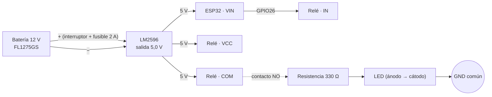

# SolarBell · Prueba rápida: batería → ESP32 → relé → LED

Rama: `main`. Objetivo: comprobar que la batería alimenta el ESP32 a través del regulador
(LM2596) y que el ESP32 activa un relé real que enciende un LED.

Diagrama de cableado: [`diagrama_prueba_rele.svg`](diagrama_prueba_rele.svg)

## 1. Cambio hecho en el firmware

En `ESP32/solarbell_local/configuracion.h` se activó el relé en GPIO26:

```c
#define PIN_LED 2          // LED azul integrado (sigue indicando el estado)
#define PIN_RELE 26        // IN del módulo de relé
// #define RELE_ACTIVO_EN_BAJO 1   // descomentar solo si el relé funciona al revés
```

`fijarRele()` conmuta GPIO26 junto con el LED azul, así que el resto del firmware no cambia.
Hay una copia de seguridad del archivo anterior en el home del equipo (`configuracion.h.bak`).

## 2. Esquema



## 3. Conexiones

| Origen | Destino |
| --- | --- |
| Batería (+) → interruptor (→ fusible 2 A) | IN+ del LM2596 |
| Batería (−) | IN− del LM2596 |
| OUT+ del LM2596 (5 V) | VIN del ESP32 |
| OUT− del LM2596 | GND del ESP32 |
| OUT+ del LM2596 (5 V) | VCC del módulo de relé |
| OUT− del LM2596 | GND del módulo de relé |
| GPIO26 del ESP32 | IN del módulo de relé |
| OUT+ del LM2596 (5 V) | COM del relé |
| NO del relé | resistencia 330 Ω → ánodo (pata larga) del LED |
| Cátodo (pata corta) del LED | GND común |

NC del relé queda sin conectar.

## 4. Procedimiento

1. **Ajusta el LM2596 sin carga.** Conecta solo la batería a IN+/IN−, mide OUT+/OUT− y gira el
   potenciómetro azul hasta leer **5,0 V**. Desconecta la batería.
2. Arma todo el circuito con el interruptor en OFF y revisa la polaridad.
3. Compila y sube el firmware **por USB, con la batería desconectada**:
   `arduino-cli compile --fqbn esp32:esp32:esp32 ESP32/solarbell_local` y luego sube con tu flujo habitual.
4. Desconecta el USB, enciende el interruptor: el ESP32 arranca con la batería.
5. Conéctate a la red Wi-Fi `SolarBell` desde el celular y toca la campana desde la app.
6. Resultado esperado: se oye el clic del relé y el LED externo se enciende junto con el LED azul.

## 5. Precauciones

- No alimentes el ESP32 por USB y por VIN al mismo tiempo.
- Todas las tierras deben estar unidas (batería, LM2596, ESP32, relé, LED).
- El LED va siempre con resistencia y desde los 5 V, nunca directo a los 12 V.
- Un fusible o el interruptor en el positivo de la batería evita daños por un corto.

## 6. Si algo falla

| Síntoma | Causa probable | Qué hacer |
| --- | --- | --- |
| El relé está activo en reposo y se apaga al tocar | Módulo activo en LOW | Descomentar `#define RELE_ACTIVO_EN_BAJO 1` y volver a subir |
| El relé no hace clic | VCC o GND del relé sin conectar, o 5 V insuficientes | Medir VCC–GND del relé (debe ser ~5 V) |
| El relé hace clic pero el LED no enciende | LED al revés, falta GND, o LED en NC en lugar de NO | Revisar polaridad y que el LED esté en COM/NO |
| El ESP32 no arranca con batería | LM2596 mal ajustado o tierra sin unir | Medir 5 V en VIN y unir GND |
| El ESP32 se reinicia al accionar el relé | Caída de voltaje del buck | Revisar cables y conexiones sueltas |

## 7. Siguiente paso

Cuando la prueba funcione, se puede reemplazar el LED por el circuito real de la campana
(contactos del relé a la carga) y agregar el DS3231 (`#define USAR_DS3231 1`, SDA GPIO21, SCL GPIO22)
para que el horario sobreviva a un corte de energía.
